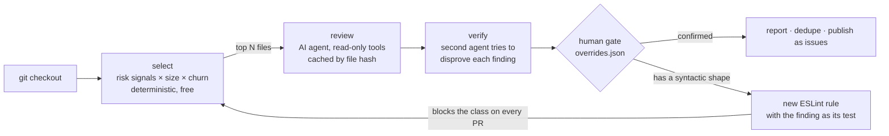

# agentic-code-review

**An AI agent finds the bugs, an adversarial agent and a human verify them, and deterministic ESLint rules make sure that class of bug never comes back.**

`qr` is a CLI and a GitHub Action for JavaScript/TypeScript repositories. It looks for behavioural defects that linters and metrics miss (leaks, races, lost cancellations, swallowed errors, crashes on error paths) and keeps the result as reviewable state in git, so each run only pays for what changed.

| Case study | Scope | Result |
|---|---|---|
| [**QVAC**](case-studies/qvac/) (Tether's local-AI SDK) | 1,013 files, top 40 reviewed by the agent | 47 candidates → **32 confirmed defects** (10 reproduced by script), 16 rejected with reasons; 6 rules written from them, 91% precise, which found 1 more bug. $27.47 for the first run, $0 for a re-run |
| [**Nx**](case-studies/nx/) (build system) | 2,391 files, rules only | 7 rule hits in 11 s at $0: **5 leads** (read, not yet reproduced), 2 accepted. The first pass exposed 10 noisy hits, and the rules were fixed |
| **Vite** | 143 files, rules only | 0 hits: no false alarms on a clean codebase |

## How it works



1. **Select** (deterministic, about 10 s, free). Files are ranked by risk signals (child processes, filesystem, network, untrusted parsing, timers, listeners, promises) times size times recent churn. The ranking is written to `selection.json`, so every choice can be checked.
2. **Review.** Claude Code runs headless inside the checkout with only Read, Grep and Glob, so it can follow callers and types across files. Output is schema-validated, and every quoted line is checked against the file.
3. **Verify.** A second pass gets only the claim and is told to disprove it (is it reachable, guarded elsewhere, intended, overstated?).
4. **Human gate.** A person records each decision in `state/overrides.json`. Only human-confirmed findings are filed. The agent's "confirmed" is a lead, not a fact.
5. **Prevent.** A confirmed finding with a syntactic shape becomes an ESLint rule, with the finding as its test case. Rules run on every file in seconds, block PRs through a triaged baseline, and move that bug class from the paid, advisory path to the free, blocking one.

Findings are fingerprinted by file and anchor line, not line number, so a re-run reports each one as present, moved or gone. Model answers are cached by prompt version, model and file hash. More in [docs/design.md](docs/design.md).

## Use it

**On your repository, from a checkout of this one** (Node 22+, git, and the [Claude Code](https://docs.anthropic.com/en/docs/claude-code) CLI logged in or `ANTHROPIC_API_KEY` set for the agent stages):

```bash
npm ci
npx tsx src/cli.ts -w .qr init ../your-repo        # writes .qr/qr.config.json (name, scope, GitHub repo)
npx tsx src/cli.ts -w .qr rules ../your-repo       # deterministic rules, seconds, $0
npx tsx src/cli.ts -w .qr run ../your-repo --select-only   # the files the agent would review, $0
npx tsx src/cli.ts -w .qr run ../your-repo         # select → review → verify → .qr/results/FINDINGS.md
```

Then read `FINDINGS.md`, record decisions in `.qr/state/overrides.json`, and run `report` to re-rank, `dedupe` to search upstream issues and PRs, and `publish` to file confirmed findings in a repo you control. `qr --help` lists every command, and `pr` checks one change against a base ref.

**On every pull request, as a GitHub Action.** Commit `.qr/qr.config.json` (and `.qr/state/rules-baseline.json` once you have triaged hits), then:

```yaml
on: pull_request
permissions: { contents: read, pull-requests: write }
jobs:
  review:
    runs-on: ubuntu-latest
    steps:
      - uses: actions/checkout@v4
        with: { fetch-depth: 0 }
      - uses: carlocifarelli/agentic-code-review@main   # pin to a commit
        with:
          anthropic-api-key: ${{ secrets.ANTHROPIC_API_KEY }}   # optional: rules only without it
```

Rule hits not in the baseline fail the check, and agent leads are posted as advice in one sticky comment. This repository runs the action on itself in [CI](.github/workflows/ci.yml).

**Just the rules, in your own ESLint config** (`npm i -D github:carlocifarelli/agentic-code-review`):

```js
// eslint.config.js
import hygiene from 'agentic-code-review/eslint-plugin'
export default [hygiene.configs.recommended]
```

| Rule | Flags |
|---|---|
| `abort-signal-race` | an `abort` listener added, or a signal passed on, after an await without re-checking `signal.aborted` |
| `close-on-error` | a resource created locally, then an await that can throw before it is handed off or closed (classes configurable) |
| `exit-code-ignores-signal` | `process.exit(code \|\| 0)` in a child's exit handler: a signal-killed child reports success |
| `spawn-without-error-listener` | `spawn()` whose child has no `error` listener: a failed start becomes an uncaught exception |
| `stale-error-reject` | `server.on('error', reject)` that outlives the startup promise and swallows later errors |
| `throw-in-promise-listener` | a sync call that can throw inside an event listener in a `new Promise` executor |

**Keeping code private:** `backend: "openai-compatible"` runs review and verify on a local server (llama.cpp, Ollama, vLLM, `qvac serve --openai`), so no code leaves the machine. It works end to end, but measured against the QVAC findings, today's local models recall almost none of them ([numbers](case-studies/qvac/docs/DETAILS.md#running-on-qvac-itself-a-local-model-no-code-leaves-the-machine-demonstrated-measured-with-two-models)).

## Design choices

| Choice | Instead of |
|---|---|
| Spend model effort on behaviour, not metrics | More metrics or SonarQube, which most mature repos already have |
| An agent with read-only tools | One prompt with the file pasted in: cheaper, but blind to callers |
| An adversarial second pass, then a human | Trusting the model's confidence |
| State as JSON in git, with anchor fingerprints | A database, or issues as the only store |
| Rules generated from confirmed findings | Running a model on every commit forever |
| Rules block, agents advise | Letting a non-deterministic check fail a build |

**Cost.** About $0.35 per file reviewed and $0.30 per verification with Opus; $0 for unchanged files; cents to about $2 per PR. Rules and the local backend are free.
**Security.** The agent cannot write, execute or browse. Prompt injection from repository content is mitigated (read-only tools, schema, anchor checks, second pass, human gate), not eliminated. `publish` refuses to file into the upstream repository.

## Limitations

- **Recall is unknown.** There is no labelled bug set yet; the agent reviews the top N files by risk, not all of them.
- **The agent verifier is lenient.** On QVAC I rejected 8 of its 39 confirmations, which is why a human decides.
- **Rules are intra-file**, and they were written after seeing the findings. The Nx run is their first test on unseen code: it needed two precision fixes.
- **Dedupe is keyword search.** It records what was searched; it cannot prove that a bug was never reported.

## Repository

```
src/            CLI (cli.ts), stages (select, review, verify, rules, pr, dedupe, publish), backends, rules
test/           unit tests and RuleTester cases built from the confirmed findings (npm test)
action.yml      the GitHub Action
docs/design.md  design notes: selection, identity across runs, ranking, workflow
case-studies/   one folder per target: config, state (decisions, cache, baseline), results
```

## Origin

I built the first version in one day as a take-home exercise in a hiring process: assess the code quality of the QVAC monorepo with a solution that can be reused. About five hours went into the pipeline and the first 31 confirmed findings, the rest of the day into the rules, the PR workflow and the local-model backend. Afterwards I made it target-agnostic and ran it on Nx and Vite. The QVAC findings are tracked as issues in this repository. How I used AI to build it is in [AI_USAGE.md](AI_USAGE.md).

MIT licensed. Built by Carlo Cifarelli.
